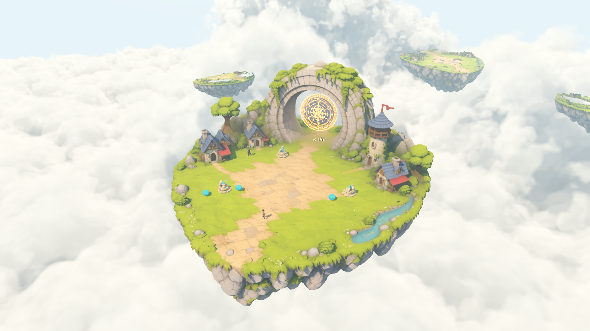
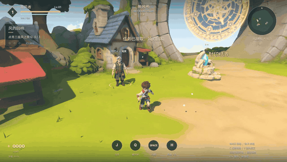
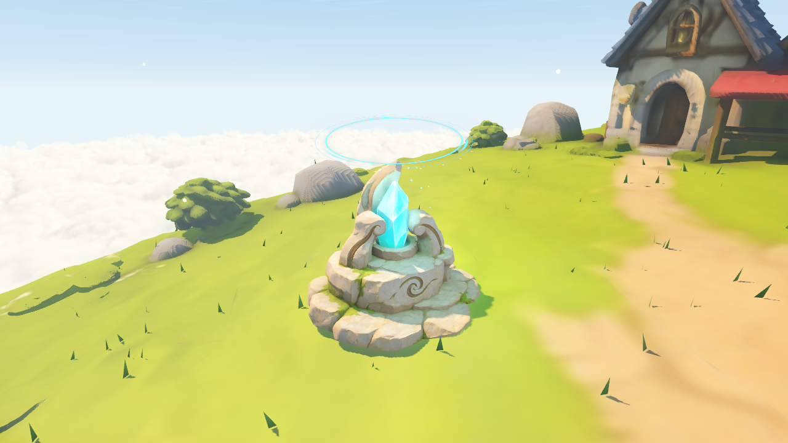
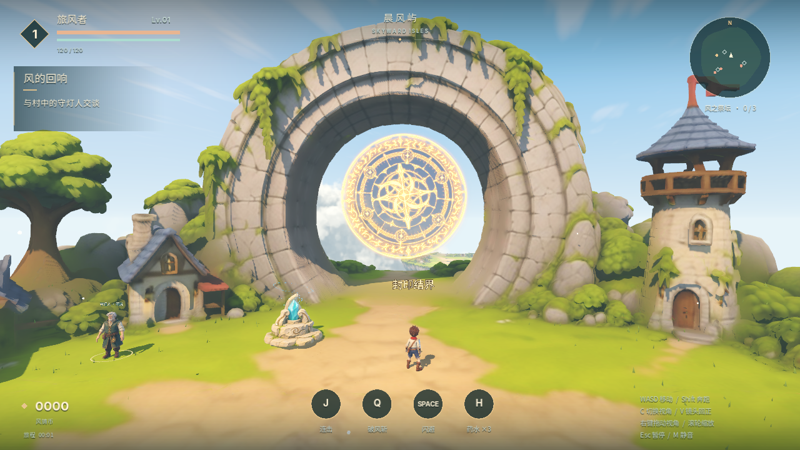
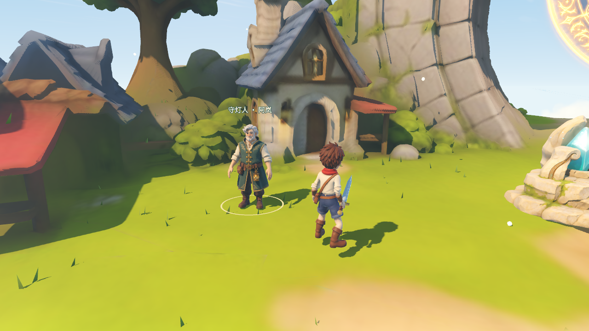
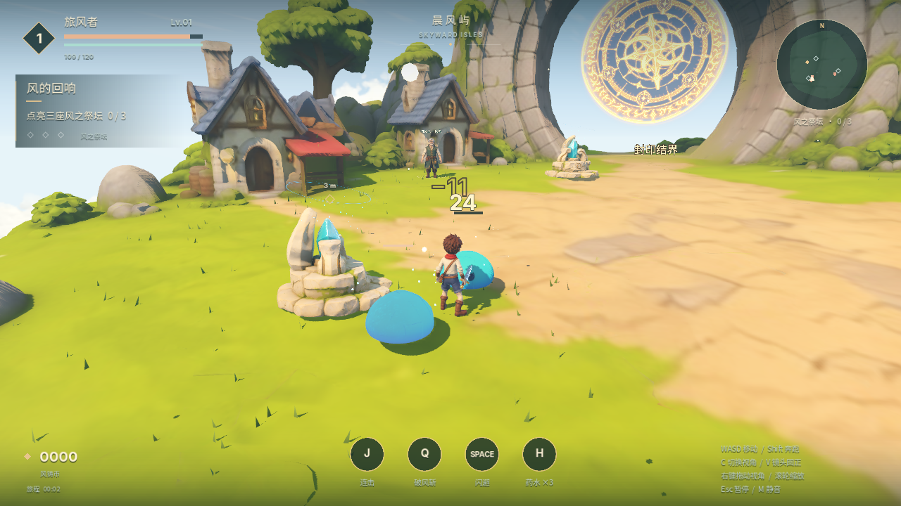
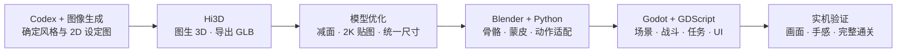

# 云屿纪行 · The Skyward Isles

**不懂建模，也能用 Codex + Hi3D + Blender + Godot 做一款可玩的 3D 动作 RPG。**

在云海上的晨风屿，扮演持剑的旅风者，与守灯人阿岚对话，清理史莱姆、点亮三座风晶祭坛，击败星门守卫，开启通往下一段旅程的门。

[](https://godotengine.org/)
[](LICENSE)
[](https://www.blender.org/)



[观看实机视频](https://github.com/ziho7/skyward-isles/releases/latest/download/skyward-isles-demo.mp4) · [下载源码](https://github.com/ziho7/skyward-isles/archive/refs/heads/main.zip) · [制作过程](docs/MAKING_OF.md) · [开发与验证](docs/DEVELOPMENT.md)

## 效果展示

下面的画面和视频直接录制自 Godot 中运行的开源版本。

[](https://github.com/ziho7/skyward-isles/releases/latest/download/skyward-isles-demo.mp4)

**[▶ 完整实机演示 · MP4，含游戏音效](https://github.com/ziho7/skyward-isles/releases/latest/download/skyward-isles-demo.mp4)**

| 水晶祭坛 | 星门封印 |
| --- | --- |
|  |  |

| 与守灯人同行 | 战斗与技能 |
| --- | --- |
|  |  |

## 可以玩到什么

- **一章完整流程**：接取委托 → 清理村口 3 只史莱姆 → 点亮 3 枚风晶 → 挑战 Boss → 解锁星门。
- **动作战斗**：正斩 / 反斩交替、第三击强化、破风斩、耐力消耗、闪避无敌帧、受击反馈和药水。
- **敌人与交互**：追击、扑击预警、脱离返营、NPC 对话安全区、祭坛与星门碰撞。
- **成长与存档**：经验、升级、风铸币、药水、自动保存、继续游戏与重新挑战。
- **可调镜头**：右键旋转、滚轮缩放，近景 / 战斗 / 俯视三档切换。
- **实时视觉**：光线步进云海、风动草叶、水晶光晕、旋转符文、剑光与粒子。

这是一个**单人、本地运行的 3D 游戏原型**。当前只有一座可探索岛屿，尚无联网、室内地图、多章节、装备背包或移动端适配。

## 快速开始

### 用 Godot 打开

1. 安装 [Godot 标准版](https://godotengine.org/download/)；本仓库验证版本为 **4.7.2**，无需 .NET。
2. 克隆仓库，或者下载上面的源码 ZIP 并解压。
3. 在 Godot 项目管理器中点击「导入」，选择根目录的 `project.godot`。
4. 等待首次模型和字体导入完成，按 **F5** 运行主场景；菜单点击「踏上旅程」或按 Enter。

```sh
git clone https://github.com/ziho7/skyward-isles.git
cd skyward-isles
godot --headless --editor --path . --import
godot --path .
```

> 运行游戏只需要 Godot。仓库已包含可用模型、贴图、动作、字体和音效，不需要 Hi3D 账号、API Key、Blender、Python 或 Node.js。首次导入可能需要一些时间。

### macOS / Linux 启动脚本

```sh
./run.sh
```

macOS 也可以双击 `启动游戏.command`。脚本会寻找 PATH 中的 `godot` / `godot4`，以及 `/Applications/Godot.app`。安装在其他位置时：

```sh
SKYWARD_GODOT="/path/to/Godot" ./run.sh
```

Windows 请从 Godot 项目管理器导入项目，或将上述命令中的 `godot` 换成 Godot 可执行文件路径。

默认使用 **Forward+** 渲染，macOS 使用 Metal；Windows / Linux 需要支持相应渲染后端的显卡。已在 Apple M3 Pro / macOS 上验证；其他平台尚未实机验证。不要直接切换 Compatibility 并期待云海和发光效果完全一致。

### 演示模式

```sh
godot --path . -- --demo
```

也可在 macOS 双击 `启动演示.command`。演示模式保留主菜单和入口 3 只史莱姆，预先点亮两座祭坛，方便展示最后一座祭坛与 Boss；它不读取或覆盖正常存档。

## 操作

| 按键 | 操作 |
| --- | --- |
| WASD / 方向键 | 相对镜头移动 |
| Shift | 奔跑 |
| 鼠标左键 / J | 普攻；连续输入衔接正反斩，第三击强化 |
| Q / K | 破风斩，消耗耐力，7 秒冷却 |
| 空格 | 闪避，短暂无敌 |
| E / Enter | 交谈、接取任务、点亮祭坛、进入星门 |
| H | 使用药水 |
| 按住右键拖动 / 滚轮 | 旋转 / 缩放镜头 |
| C / V | 切换镜头档位 / 回到主角背后 |
| Esc | 暂停或继续，关闭对话 |
| M | 静音 / 恢复声音 |
| Tab / F11 | 隐藏界面 / 全屏切换 |
| F9 | 截图到 `captures/` |
| R | 在菜单、暂停或结算界面重新开始本章，重置进度 |

接到任务后，先清理入口附近敌人，再靠近祭坛按 E。后方祭坛没有守怪，接取任务后可直接点亮。三座祭坛全部激活后，星门前出现 Boss；击败它，再靠近门按 E 完成本章。

## 这是怎么做出来的

最开始，我尝试让 AI 直接生成整个 3D 游戏。玩法能够搭起来，但场景和人物主要由基础几何体组成，美术效果达不到预期。后来把工作拆成了**设定图、3D 资产、动画、游戏逻辑**四个部分。



1. **先有统一的美术设定。** 用 Codex 配合图像生成制作云岛建筑、少年、短剑、史莱姆、守灯人和水晶祭坛的参考图。
2. **用 Hi3D 把图变成模型。** 导出 GLB，保留模型细节与贴图，再做减面、材质处理和贴图压缩。
3. **让静态人物动起来。** Codex 编写 Blender Python 脚本，为主角建立 21 根骨骼与剑挂点，制作蒙皮；引入 Quaternius 的 CC0 动作，适配身材、修正 A/T 姿势差异和脚底接触，导出 12 个动作。
4. **在 Godot 里搭成游戏。** 用 GDScript 连接移动、碰撞、攻击时机、连击、闪避、敌人、任务、存档和 HUD。云海、草叶、祭坛、星门与剑光由着色器和程序逻辑完成。
5. **反复看实机，而不只看模型。** 调整镜头、攻击距离、敌人追击、NPC 待机、音效触发与星门碰撞，并通过自动路线跑完整章。

详细的脚本入口、模型优化数据、动画重定向和重建方法见 **[制作过程](docs/MAKING_OF.md)**。创作叙事参考作者的[飞书制作记录](https://my.feishu.cn/wiki/SGgWwYn0riZXptkKUemcIOD2nkc)；链接可能需要飞书访问权限，关键内容已整理在仓库内。

## 技术栈

| 环节 | 技术 / 工具 | 在项目中做什么 |
| --- | --- | --- |
| AI 辅助开发 | Codex | 拆解需求，编写游戏与工具脚本，迭代和验证 |
| 美术设定 | 图像生成 | 2D 角色、场景、道具参考及星门符文贴图 |
| 模型生成 | Hi3D | 将 2D 参考转成带贴图的 3D GLB |
| 游戏引擎 | Godot 4.7.2 / GDScript | 3D 场景、物理、战斗、任务、UI、存档与音频 |
| 渲染 | Forward+ / Godot Shader Language | 云海光线步进、发光、草叶、祭坛与星门 |
| 绑定与动画 | Blender 5.2 / Python / NumPy | 骨骼、蒙皮、动作重定向、IK 与 GLB 导出 |
| 动作素材 | Quaternius UAL 1 & 2 Standard | CC0 人形动作，经过角色比例和战斗节奏适配 |
| 模型优化 | Node.js / glTF Transform / meshoptimizer / sharp | 网格简化、合并和纹理压缩 |
| 音效制作 | Python / NumPy / WAV | 可复现的程序合成音效 |
| 中文 / 数字字体 | Noto Sans SC / Inter | SIL OFL 1.1 开源字体 |
| 演示录制 | Godot Movie Maker / FFmpeg | 实机录像、MP4 编码与 GIF 展示 |

## 仓库结构

```text
skyward-isles/
├── project.godot           # 导入这个文件即可打开游戏
├── main.tscn              # 游戏入口
├── scripts/               # 游戏、玩家、敌人、场景、HUD
├── shaders/               # 云海、草叶、祭坛、星门
├── assets/
│   ├── models/            # 优化后的 GLB、动作参数与模型统计
│   ├── audio/             # 开源版合成音效
│   ├── fonts/             # 开源字体及其许可证
│   ├── effects/           # 星门贴图与生成提示词
│   └── concepts/          # 部分原始美术参考图
├── blender/               # 主角、NPC 和基础骨架的可编辑源文件
├── tools/                 # 绑定、动作、音效、模型处理与验证脚本
│   ├── model-prep/        # Node.js 模型优化流水线
│   └── motion-source/     # 重定向用 CC0 动作和原始许可证
├── docs/                  # 制作过程、开发说明、效果图
└── run.sh                 # macOS / Linux 启动入口
```

## 开发与验证

```sh
# 首次拉取后，先导入资源
godot --headless --editor --path . --import

# 战斗、镜头、任务、祭坛与通关逻辑
godot --headless --path . -- --self-test

# 用真实移动 / 攻击 / 闪避 / 交互跑完整章
godot --headless --path . --fixed-fps 60 -- --test-route

# NPC 骨骼动画、挥剑和命中音效触发
godot --headless --path . --fixed-fps 60 --script res://tools/verify_merchant_audio.gd
```

这些模式不会覆盖正常玩家进度。完整的资源重建、录制命令、存档说明和测试范围见 [DEVELOPMENT.md](docs/DEVELOPMENT.md)。

## 许可与致谢

本项目代码、着色器、制作脚本和原创合成音效采用 **[MIT License](LICENSE)**。项目提供的生成美术在作者可授权的范围内同样按 MIT 发布；第三方字体和动作保留各自许可证，详见 [THIRD_PARTY_NOTICES.md](THIRD_PARTY_NOTICES.md)。

- 感谢 [Quaternius](https://quaternius.com/) 提供 CC0 动作素材。
- 感谢 [Godot](https://godotengine.org/)、[Blender](https://www.blender.org/) 及相关开源工具。
- 开源版已使用原创合成音效和开源字体替换开发原型中的第三方游戏音效、系统字体。

作者：**码里奥 Ziho** · [GitHub](https://github.com/ziho7)
